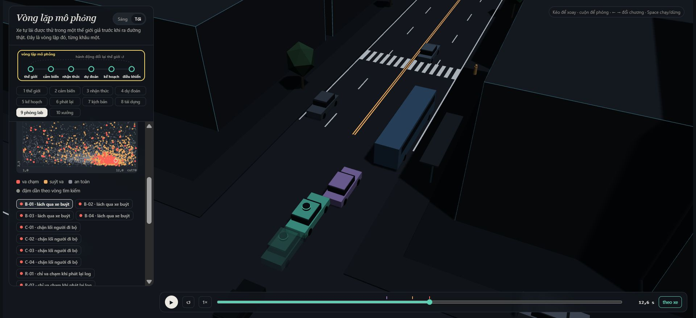
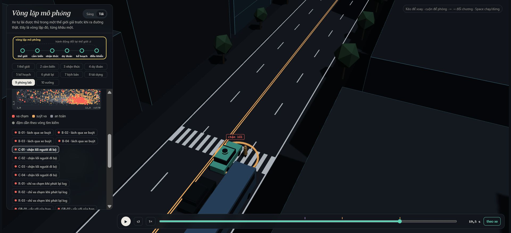
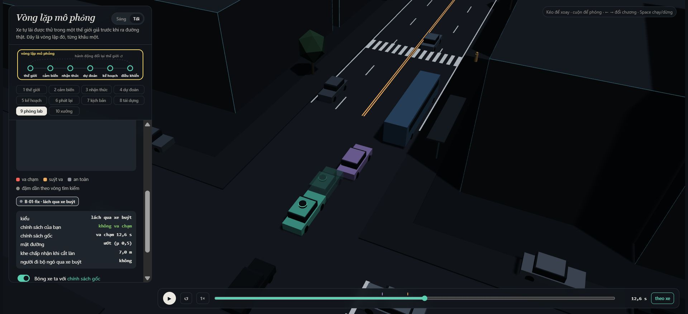
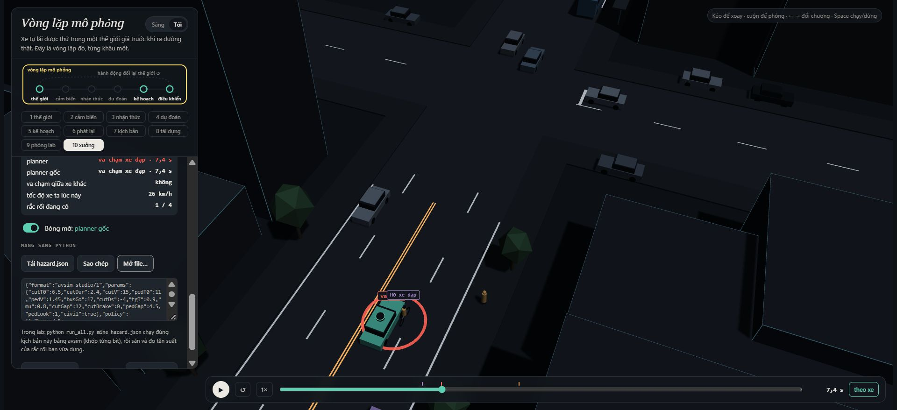

MSSV: 2A202602853

# Lab 11 · Scenario Forge — báo cáo

Mỗi câu: trả lời ngắn, **trích số từ `evidence/`** (ghi tên file và trường, ví dụ `mc.json: crashes = 4`). Grader chạy lại với MSSV của bạn; số không khớp `evidence/` thì mất điểm phần D (RUBRIC), và câu dựa trên số sai khó được điểm đầy đủ. Không cần văn hay: một bảng nhỏ và hai, ba câu giải thích là đủ.

Thị trấn của bạn (`meta.json: _run.town`): 

## 1. Phát lại log có trung thực không?

Nguồn: `evidence/replay.json`. Có 400 kịch bản; bỏ 1 log có va chạm của người lái, còn 399 kịch bản để so sánh.

| Thế giới | Tổng va chạm | front | rear | side |
|---|---:|---:|---:|---:|
| Phát lại log | 100 | 0 | 89 | 11 |
| Tác nhân phản ứng | 0 quan sát được | 0 | 0 | 0 |

`crash_in_both=0`. Log của TG chứa phản ứng với người lái trong quá khứ, không chứa phản ứng với planner mới. Khi planner phanh sớm hơn, TG vẫn theo quỹ đạo cũ nên tông đuôi ego: va chạm giả do phương pháp kiểm thử. Trong thế giới phản ứng, TG thấy ego giảm tốc và điều chỉnh IDM.

Chọn `replay_only[0]`: `scenario=2`, `contact=rear`, `min_ttc_reactive=7.460629499 s`. Cùng tham số, planner bị TG tông khi phát lại; khi giao thông phản ứng, không có sự kiện va chạm ego. Không suy ra xác suất bằng 0 từ mẫu reactive chưa thấy va chạm.

## 2. Kịch bản bất khả thi

`lab11/feasible.py` kiểm tra bốn luật:

1. Chuyển làn cosine rộng 3,5 m đòi hỏi gia tốc ngang cực đại `a_lat=(π/cutDur)^2·3.5/2`, phải không vượt `μg`. `cutDur<=0` cũng bị loại vì không có thời gian chuyển làn vật lý.
2. Phanh sau nhập làn `cutBrake<=μg`: lực bám lốp giới hạn giảm tốc.
3. `pedV<=2.5 m/s`: miền người đi bộ của bài không gồm người chạy nhanh.
4. `0<cutV<=22 m/s`: xe nhập làn phải có tốc độ dương, không vượt giới hạn miền mô phỏng.

Giới hạn tốc độ là giả định miền vận hành của lab, không phải định luật cấm xe chạy nhanh hơn 22 m/s ngoài đời. Lõi lọc kịch bản trước khi chạy; kịch bản bị loại có nhãn `infeasible`, không tính là thất bại. MC loại 16/3.000 mẫu (`mc.json: infeasible`).

Nguồn: `evidence/hunt.json: <mode>.found, infeasible`.

| Mục tiêu săn | Số tìm theo nhãn | Bất khả thi đã loại |
|---|---|---:|
| bus_bypass | bus_bypass: 168 | 2 |
| cut_in | bus_bypass: 22 | 1 |
| crosswalk_block | crosswalk_block: 77, bus_bypass: 1 | 11 |
| rear_ended | bus_bypass: 17, crosswalk_block: 6 | 5 |

Cuộc săn `crosswalk_block` loại nhiều nhất: 11/2.400 mẫu (0,4583%). Tổng bốn cuộc săn loại 19/9.600 mẫu. Điểm dừng/phanh quanh người đi bộ có thể cải thiện bằng các cấu hình chuyển làn hoặc ma sát cực đoan nên CEM vẫn cần lọc vật lý ở mỗi vòng.

CEM ưu tiên điểm nguy hiểm cao nên dễ bị kéo về chuyển làn quá nhanh hoặc phanh quá ma sát. Nếu tính các cảnh này là thất bại, ước lượng bị tăng bởi sự kiện không xảy ra trong miền vật lý cho phép; đồng thời proposal bị lãng phí vào vùng không hợp lệ. Không được thay mẫu số MC bằng số mẫu khả thi: runner định nghĩa biến chỉ báo thất bại bằng 0 cho mẫu bất khả thi trong phân phối gốc.

## 3. Monte Carlo cho biết gì?

Nguồn: `evidence/mc.json`:

| n | k | p̂ | Wilson 95% |
|---:|---:|---:|---|
| 3.000 | 3 | 0,001 | [0,000340141063; 0,002936196810] |

Cả 3 thất bại thuộc `bus_bypass`. Để nửa độ rộng khoảng chuẩn xấp xỉ còn 20% của p, `n≈1.96²(1-p)/(0.2²p)≈95.943`; quy tắc lab `n≈96/p` cho **96.000 lần chạy**. Đây là dự toán dựa trên p̂ còn rất bất định, không bảo đảm 96.000 lần sẽ cho chính xác cùng độ rộng.

`cut_in`, `crosswalk_block`, `rear_ended` và `other` đều chưa xuất hiện. Mỗi kiểu phải báo **0 lần quan sát, Wilson [0; 0,001278895665]**, không báo xác suất thực bằng 0 (`mc.json: per_mode`). Rule of three cho cận xấp xỉ `3/3000=0.001`; báo cáo dùng Wilson đúng theo yêu cầu.

## 4. Importance sampling, ESS và độ suy biến

Nguồn: `evidence/estimate.json: seeds[i].per[mode]`. Dòng chưa có hit ghi cận zero-hit, không diễn giải p̂=0 là xác suất thực bằng 0.

| Kiểu | Seed | p̂ hoặc cận zero-hit | hits | ESS | top_share |
|---|---:|---:|---:|---:|---:|
| bus_bypass | 0 | 0.00102284334 | 36 | 115.093595 | 0.542539 |
| cut_in | 0 | ≤ 0.025 (cận 95%) | 0 | 113.066923 | 0.000000 |
| crosswalk_block | 0 | 6.14682674e-07 | 114 | 115.048995 | 0.228002 |
| rear_ended | 0 | ≤ 0.025 (cận 95%) | 0 | 138.362124 | 0.000000 |
| bus_bypass | 1 | 0.0013086735 | 28 | 139.196742 | 0.629721 |
| cut_in | 1 | ≤ 0.025 (cận 95%) | 0 | 130.810007 | 0.000000 |
| crosswalk_block | 1 | 4.78659306e-07 | 122 | 113.082607 | 0.341005 |
| rear_ended | 1 | ≤ 0.025 (cận 95%) | 0 | 109.897956 | 0.000000 |
| bus_bypass | 2 | 0.000361120164 | 33 | 129.082891 | 0.414702 |
| cut_in | 2 | ≤ 0.025 (cận 95%) | 0 | 112.903213 | 0.000000 |
| crosswalk_block | 2 | 8.14477134e-07 | 124 | 110.017350 | 0.736294 |
| rear_ended | 2 | ≤ 0.025 (cận 95%) | 0 | 128.185527 | 0.000000 |

| Seed | Tổng điểm ước lượng | Khoảng tổng xấp xỉ do runner ghi |
|---:|---:|---|
| 0 | 0.00102345801894 | [0; 0.00343748919662] |
| 1 | 0.0013091521628 | [0; 0.00425654422233] |
| 2 | 0.000361934641416 | [4.49800099702e-05; 0.00195778493767] |

Trung vị tổng **0.00102345801894**, lớn nhất/nhỏ nhất **3.617096 lần**. Các điểm ước lượng đều nằm trong khoảng Wilson MC [0,000340141063; 0,002936196810], nhưng mức dao động còn lớn; chưa có bằng chứng IS chính xác tới ±20%.

Các trường hợp `top_share>0.5`:
- bus_bypass, seed 0: **0.542539**.
- bus_bypass, seed 1: **0.629721**.
- crosswalk_block, seed 2: **0.736294**.

Ước lượng `bus_bypass` bị chi phối bởi một mẫu ở hai seed. Seed 2 của `crosswalk_block` cũng có một mẫu quyết định gần ba phần tư tổng trọng số sự kiện; nhiều hit không tự động đồng nghĩa nhiều thông tin về p.

Ngân sách `estimate.json: budget=16800` = 4·(8·300+3·600) = **9.600 lần săn + 7.200 lần IS**. Chưa gồm 3.000 MC, replay, fix và mine. So với MC dự toán 96.000 mẫu để đạt ±20% ở p≈10⁻³, ngân sách này ít hơn **5.714286 lần**, nhưng chưa đạt cùng độ chính xác, nên đây chỉ là so chi phí, không phải chứng minh hiệu quả bằng nhau.

| Seed | SE của tổng (không tính cận other) | Nửa độ rộng 1,96SE / tổng | n_MC cho cùng sai số tương đối xấp xỉ |
|---:|---:|---:|---:|
| 0 | 0.000579150772 | 1.109118 | 3,049 |
| 1 | 0.000851273671 | 1.274486 | 1,805 |
| 2 | 0.000161711547 | 0.875723 | 13,836 |

Dự toán hàng cuối giả định p bằng điểm IS và SE ổn định, điều chưa chắc đúng với top_share cao. Chi phí chung 16.800 còn bao gồm săn và cả ba seed, không thể đối chiếu một seed như một phép thử độc lập có cùng ngân sách.

`other`: k=0, n=3000, nguồn `mc.json`, cận Wilson **0.0012788956648**. Không quan sát được sự kiện other trong MC; runner cộng cận này vào đầu trên tổng.

Khoảng tổng của runner là xấp xỉ dựa trên SE; nó không cộng `upper_zero_hits` của `cut_in` và `rear_ended` vào tổng. Vì vậy không dùng đầu trên này để chứng nhận toàn bộ xác suất, và luôn báo riêng cận 0,025 của từng kiểu chưa có hit.

Trọng số là `w=p(u)/[0.8q_CEM(u)+0.2p(u)]`, tính log bằng `logaddexp`; ước lượng là `mean(w·y)`, không tự chuẩn hóa theo tổng trọng số. ESS Kish đo sự lệch của trọng số trên toàn mẫu; không phải số thử độc lập để thay vào rule of three. Với kiểu không có hit, cận riêng `3/(0.2·600)=0.025`.

`top_share` là tỷ lệ tổng `w·y` do mẫu lớn nhất đóng góp. Nếu lớn hơn 0,5, một kịch bản quyết định hơn nửa ước lượng nên khoảng dựa trên SE chuẩn có thể quá lạc quan. `top_share` nhỏ cũng không chứng minh q đã phủ hết vùng thất bại.

Phần `other` được lấy từ MC, vì bốn nhãn săn chưa phủ toàn bộ tập thất bại; `other` không có cơ chế/điểm nguy hiểm riêng để săn hiệu quả. Khi MC chưa thấy `other`, phải giữ cận Wilson của phần đó trong khoảng tổng.

## 5. Các kiểu thất bại và ảnh 3D

Tổng số nhãn tìm được trên bốn cuộc săn: **208 bus_bypass** và **83 crosswalk_block** (`hunt.json: tổng found`); không có `cut_in` hoặc `rear_ended` đúng nhãn.

- **Bus bypass:** C2 chờ khe rồi lách xe buýt đang dừng, tốc độ giảm dưới 6 m/s tại x<112 m; ego chưa theo kịp thay đổi hành lang phía trước và va vào C2. Ảnh được chốt theo một run xuất từ `viewer.json`, tại đúng sự kiện.
- **Crosswalk block:** P1 không nhìn qua xe buýt nên bị che; chỉ bước ra khi khe của xe nhìn thấy đủ rộng. Ego phát hiện muộn, phanh nhưng thân xe dừng trên vạch chặn P1. P1 đứng lại trước thân xe; sự kiện `kind=block`, không nhận nhầm là tiếp xúc xuyên thân xe.

Nguồn ảnh: chương 9 mở `viewer.json`; nguồn kiểm tra frame bằng Python: `evidence/shot_scenarios.json` (phát lại bổ sung chính tham số B-01 và C-01, không phải một phép ước lượng xác suất mới).

**B-01, frame 252, 12,6 s:** ego x=90.930588 m, v=3.562647 m/s; C2 x=95.440887 m, v=0.935496 m/s; xe buýt gần như dừng (v=0.380486 m/s). C2 đã chờ khe rồi lấn sang để lách buýt, nhưng giảm tốc mạnh trước chướng ngại; ego nhận hành lang quá muộn và chạm C2. Đây là `kind=contact`, thỏa x_C2<112 m và v_C2<6 m/s. Đường ướt μ=0,5 hạn chế lực phanh. Ảnh có bóng mờ bản sửa vì run baseline trong viewer được pin policy gốc; câu 6 dùng ảnh riêng để đổi thứ tự xe đậm/bóng mờ.

**C-01, frame 390, 19,5 s:** ego dừng ở x=120.480339 m, v=0; đầu xe ở x=122.780339 m, vượt vạch x=122 m. P1 cũng đứng lại, v=0. Người đi bộ không ngó qua buýt (`pedLook=0`), bị che trước khi bước ra; buýt đang nhường họ, nhưng ego phanh trên đường μ=0,5 quá muộn nên thân xe chặn lối. Sự kiện là **block**, không phải P1 bước xuyên vào xe. Bản sửa cutinLat=3 cũng còn block đúng cảnh này, cho thấy nó chưa giải quyết cơ chế người đi bộ.

Không tìm được một nhãn không chứng minh nhãn đó có xác suất bằng 0: ngân sách hữu hạn, điểm nguy hiểm có thể lệch cơ chế, và proposal bị co. Ví dụ cuộc săn `cut_in` có 22 hit nhưng tất cả là `bus_bypass`; cuộc săn `rear_ended` có 17 `bus_bypass` và 6 `crosswalk_block`. Một cuộc săn duy nhất sẽ dễ dành ngân sách cho kiểu dễ tìm rồi bỏ qua kiểu người đi bộ hiếm hơn; cuộc săn `bus_bypass` riêng có 168 hit và không có block.

Một cuộc săn chung dễ co về vùng thất bại dễ đạt điểm cao nhất. Săn riêng giúp tìm cơ chế khác nhau; số hit của cuộc săn không phải tần suất tự nhiên vì mẫu được rút từ proposal thích nghi.

## 6. Sửa planner: TRAIN và TEST

Nguồn: `evidence/fix.json`. Policy được chọn là **`{"cutinLat": 3.0}`**; các núm khác giữ mặc định. Ngưỡng coi C2 là leader được nâng từ 2,15 lên 3,0 m, giúp ego phản ứng khi C2 mới lấn sang.

| Mẫu / policy | fail | fail_hi_seen | fail_hi | Quãng đường (m) | Frame phanh gấp trung bình |
|---|---:|---:|---:|---:|---:|
| TRAIN baseline | 0.00044208021555 | 0.000825522291987 | 0.000825522291987 | 216.169791222 | 8.167968750 |
| TRAIN được chọn | 5.39566273568e-07 | 1.39168864536e-06 | 1.39168864536e-06 | 216.163561583 | 7.699218750 |
| TEST baseline | 0.000359984913792 | 0.000687051346746 | 0.00196594701155 | 217.259684377 | 8.047000000 |
| TEST được chọn | 1.58193697936e-07 | 2.54148965723e-07 | 0.0387791498138 | 217.244378688 | 7.603333333 |

Ngưỡng TRAIN: **205.361301661 m**. Policy được chọn đạt 216.163561583 m, mất **0.002881827%**; ứng viên `cautionV=5`, `6`, `6.5` không đủ ngưỡng tiến độ. Trên TEST mất **0.007044883%**. Không dùng TEST để đổi ứng viên.

| Ứng viên TRAIN | fail_hi | Quãng đường (m) | Đạt 95% tiến độ? |
|---|---:|---:|---|
| `{"cautionV": 5.0}` | 1.75277178817e-05 | 173.697552 | Không |
| `{"cautionV": 6.5}` | 0.000228009210323 | 200.212057 | Không |
| `{"cautionV": 6.0}` | 9.90118207233e-05 | 189.548940 | Không |
| `{"cautionV": 9.0}` | 0.00106783169099 | 229.553143 | Có |
| `{"cautionV": 8.5}` | 0.00106298786102 | 226.504030 | Có |
| `{"cutinLat": 2.6}` | 6.9772040377e-05 | 216.167108 | Có |
| `{"cutinLat": 3.0}` | 1.39168864536e-06 | 216.163562 | Có |
| `{"cutinLat": 3.3}` | 1.39168864536e-06 | 216.160538 | Có |
| `{"T": 2.0}` | 0.00131655229095 | 207.253779 | Có |
| `{"cutinLat": 3.0, "cautionV": 6.5}` | 1.51158865782e-06 | 200.183824 | Không |
| `{"cutinLat": 3.0, "cautionV": 7.0}` | 1.43709674612e-06 | 209.184061 | Có |
| `{"cutinLat": 2.6, "cautionV": 7.0, "pedBuffer": 3.5}` | 1.43709674612e-06 | 209.189068 | Có |

TEST bản sửa: `bus_bypass.hits=0`, n=400, cận riêng **0.0375**; `crosswalk_block.hits=50`; ngoài hai kiểu săn có **0/3.000** thất bại (`other_crashes`), Wilson hi **0.0012788956648**. Do đó `fail_hi=0.0387791498138` = 0.0375 + 2.54148965723e-07 + 0.0012788956648. `fail_hi_seen` không gồm hai phần zero-hit, không được dùng nó để chứng nhận toàn policy.

`T=2.0` nghe có vẻ an toàn hơn nhưng TRAIN fail **0.000730019839457**, cao hơn baseline **0.00044208021555** khoảng **1.651329 lần**; tiến độ giảm xuống 207.253778756 m. T lớn làm ego giữ khe dài và đi chậm hơn; C2 đánh giá khe phía sau từ quỹ đạo đang phản ứng đó rồi có thể nhập làn ở thời điểm khác. Người đi bộ cũng quyết định theo xe họ nhìn thấy, nên đổi tốc độ ego có thể đổi thời điểm bước ra. Phân tích cơ chế này dựa trên IDM và gate trong `avsim/core.py`, không coi tăng một núm là cải thiện đơn điệu. Dữ liệu TRAIN cho thấy rủi ro trọng số tăng dù số frame phanh gấp giảm; không đủ căn cứ kết luận T=2 luôn nguy hiểm hơn ngoài đời.

Ảnh mở `evidence/fix_viewer.json`, dẫn xuất từ B-01 của `viewer.json` với cùng tham số đầy đủ: xe đậm dùng cutinLat=3, bóng mờ dùng baseline. Python phát lại (`shot_scenarios.json: bus_bypass`) xác nhận baseline contact tại 12,6 s, bản sửa không có sự kiện ego trong 24 s. File này phục vụ đảo cách hiển thị để bóng mờ đúng là baseline; kết quả TRAIN/TEST vẫn lấy từ `fix.json`.

Các ứng viên có sẵn được chấm trên cùng TRAIN; `choose_policy` chọn `fail_hi` thấp nhất với quãng đường ít nhất 95% baseline, hòa thì ưu tiên quãng đường lớn hơn. Không thêm ứng viên sau khi xem TEST. TEST dùng seed mới, săn lại dưới policy được chọn và baseline, cộng các thất bại ngoài kiểu săn từ mẫu tự nhiên riêng.

`fail_hi_seen` chỉ tính các kiểu có hit. `fail_hi` còn cộng cận của kiểu chưa thấy: với n=400, mỗi cận zero-hit IS là `3/(0.2·400)=0.0375`. Vì thế bản sửa có thể có cận trên lớn hơn điểm ước lượng của baseline dù dữ liệu quan sát cho thấy ít thất bại hơn. Không chứng nhận kiểu đã biến mất ở mức 10⁻³ bằng ngân sách này. Quãng đường được runner cắt tại va chạm; `harsh` đếm số **frame** giảm tốc dưới -3 m/s², không phải số đợt phanh độc lập.

## 7. Từ mô phỏng ra đường thật

Thị trấn D giả định `p_bin=(0.15,0.90,0.20)` cho đường ướt, người đi bộ ngó qua xe buýt, xe nhập làn phanh; `cut_gap_median=14 m` (`avsim/space.py: VARIANTS`). Ba giả định cần thay bằng đo đạc:

| Giả định | Dữ liệu và nguồn thay thế | Hướng sai lệch nếu giả định sai |
|---|---|---|
| Khe xe nhập làn có median 14 m, lognormal và giới hạn cố định | Quỹ đạo vị trí/tốc độ xe ở cả hai làn, khe trước/sau lúc bắt đầu nhập; highD cung cấp quỹ đạo và chuyển làn tự nhiên, rồi phải hiệu chỉnh bằng video drone tại phố có xe buýt tương tự | Nếu người lái thực chấp nhận khe nhỏ hơn hoặc đuôi phân phối liều lĩnh nặng hơn, mô phỏng có thể đánh giá thấp xung đột; khe thực lớn hơn có thể làm đánh giá cao. Hướng phải xác nhận vì xe phản ứng tương tác. |
| 90% người đi bộ ngó qua xe buýt | Video nhiều góc tại bến có vạch qua đường: gán nhãn nhìn quanh/khả năng nhìn thấy, thời điểm bước xuống, khe xe được chấp nhận. inD có quỹ đạo xe, xe đạp và người đi bộ để hiệu chỉnh tốc độ/khe; quỹ đạo một mình không đủ xác định hành vi nhìn nên cần gán nhãn video bổ sung | Nếu tỷ lệ nhìn thực thấp hơn 90%, người đi bộ có thể bước ra khi bị che nhiều hơn, làm xác suất block/contact bị đánh giá thấp; cần đo đồng thời khe và thời điểm, không suy nhân quả chỉ từ một tỷ lệ. |
| Đường ướt xác suất 15%, ma sát chỉ nhận 0,5 hoặc 0,8 | Nhật ký thời tiết/chuyến xe, đo ma sát mặt đường và thí nghiệm phanh theo lốp, nước, tốc độ; FHWA mô tả đo ma sát liên tục CPFM và đo điểm | Nếu μ thực nhỏ hơn 0,5 hoặc đường ướt thường xuyên hơn, quãng đường phanh dài hơn nên mô phỏng có thể đánh giá thấp thất bại; nếu ma sát cao hơn, có thể đánh giá cao. |

Nguồn tham khảo: [highD, bài báo gốc](https://arxiv.org/abs/1810.05642), [inD, đơn vị cung cấp](https://levelxdata.com/ind-dataset/), [FHWA: Pavement Friction Management](https://highways.fhwa.dot.gov/safety/proven-safety-countermeasures/pavement-friction-management). Đây là nguồn dữ liệu/phương pháp được đề xuất; không khẳng định đã tải, đo hoặc khớp phân phối từ chúng. Dữ liệu Đức không đại diện tự động cho tuyến phố Việt Nam.

## 8. Giới hạn cụ thể

1. Bản đồ cố định: một đoạn phố, 16 tác nhân gốc, thời lượng 24 s và bước 0,05 s. Xác suất không bao phủ đường cong khác, giao lộ khác, chuyến dài hoặc tình huống giữa các bước thời gian.
2. Giao thông dùng IDM, quy tắc chấp nhận khe và chuyển làn cosine; thiếu phân tâm, phản ứng chậm/khác nhau của người lái, hành vi đa dạng và đánh lái tránh va chạm của ego.
3. Cảm biến dùng vị trí trạng thái mô phỏng và che khuất hình học; thiếu nhiễu camera/LiDAR, bỏ sót nhận thức, trễ xử lý và sai số dự báo. Không thể coi xác suất này là chứng nhận an toàn của toàn stack ngoài đời.

Nếu thêm một tuần: thu/gán nhãn quỹ đạo tại tuyến mục tiêu, khớp khe và ma sát cùng bất định; chạy sensitivity trên tương quan thời tiết–hành vi và sai số nhận thức; tăng mẫu độc lập cho kiểu zero-hit, giữ một TEST mới để đánh giá mọi thay đổi. Với phòng thủ beta=0,2, muốn cận zero-hit <10⁻³ cần hơn 15.000 mẫu trên kiểu đó.

## 9. Rắc rối của học viên

**Xe đạp lạng tránh chướng ngại từ làn ngoài sang làn ego.** Cảnh dựng trong chương 10: H0 tại x=20 m, E2, lệch d=-1 m, v=3,5 m/s; lạng trái 2,4 m trong 2,3 s khi ego cách 10 m. Trình xem ghi nhận va chạm lúc **7,4 s**. Planner chủ yếu theo leader hiện tại, nên có thể nhận ra xe đạp đang vào hành lang quá muộn.

Nguồn thiết kế: `hazard.json: why`. Quét x=[0,40] m, v=[3,4] m/s, swerve=[2,2;2,6] m, swDur=[2,2;2,6] s, trig=[8,14] m. Xe đạp ban đầu cách tâm E1 2,5 m; biên lạng đưa nó vào E1. Gia tốc ngang lớn nhất `π²·2.6/(2·2.2²)=2.651 m/s²`, dưới giới hạn 3 m/s². Các khoảng là miền kiểm thử vật lý, uniform là thiết kế quét, không phải phân phối thực nghiệm ngoài đường.

**Exposure=1** vì chiến dịch tiêm một rắc rối mỗi chuyến kiểm thử. Chưa biết exposure tự nhiên. Tần suất mỗi chuyến bên dưới chỉ áp dụng cho chiến dịch này; không được so trực tiếp để kết luận xe đạp nguy hiểm hơn lách xe buýt trong giao thông tự nhiên. Nếu exposure thật là e, tần suất tương ứng là `e·P(avoidable | rắc rối)`, với điều kiện miền và phân phối xe đạp đại diện thực tế. Cần đo số lần lạng trên tổng chuyến từ video hành trình trước khi gán e.

Nguồn: `evidence/mine.json`. `exact.planner` = ego–H0 tại **7,4 s**, khớp cảnh trong chương 10. Chấp nhận **99.533333333%** = 1.493/1.500 mẫu, loại 7 mẫu vật lý không hợp lệ; `overlap_at_start=0` ở cả hai policy. `world=town`, điều kiện trên giao thông thị trấn D và miền xe đạp đã thiết kế.

| Policy | n | Tổng va chạm | avoidable | unavoidable | unattributed | low_speed | avoidable_foreknown |
|---|---:|---:|---:|---:|---:|---:|---:|
| Gốc | 1493 | 1142 | 1073 | 68 | 1 | 0 | 1073 |
| cutinLat=3,0 | 1493 | 0 | 0 | 0 | 0 | 0 | 0 |

Baseline: **P(lỗi tránh được bằng phanh | rắc rối)=0.718687206966**, Wilson 95% **[0.69534013407; 0.740911771275]**. Bản sửa: **0 lần quan sát trên 1493**, báo Wilson **[0; 0.00256647062722]**, không khẳng định xác suất bằng 0.

Với chiến dịch exposure=1, baseline có tần suất ước lượng **0.718687206966/chuyến thử**, cận trên **0.740911771275**; bản sửa chỉ có cận trên **0.00256647062722/chuyến thử**. Tần suất lách buýt tự nhiên có trung vị IS **0.00102284333626/chuyến mô phỏng** (`estimate.json: per.bus_bypass`); hai con số này thuộc hai thiết kế exposure khác nhau, không kết luận trực tiếp xe đạp ngoài đời thường gây lỗi hơn.

Nếu exposure thật là e và phân phối có điều kiện đại diện đường thật, lỗi xe đạp baseline xấp xỉ **0.718687206966·e/chuyến**; bằng trung vị bus_bypass khi **e≈0.00142321071858**. Đây là ngưỡng so sánh tính từ mô phỏng, không phải exposure đã đo. Bản sửa có cận có điều kiện để dùng trong phân tích sensitivity, chưa chứng nhận trên mọi miền xe đạp.

Ở baseline `avoidable_foreknown=avoidable=1073`: trong sweep này không có chênh lệch do oracle phải chờ nhìn thấy sau khi rắc rối bắt đầu; không suy ra che khuất không quan trọng ở mọi cảnh. Bản sửa đã cứu toàn bộ mẫu quét quan sát được; rắc rối này không vượt qua được bản sửa ở bước E, nhưng vẫn cho thấy cơ chế lỗi của planner gốc.

Phân loại: `avoidable` là oracle phanh tối đa ngay frame đầu rắc rối đã bắt đầu **và nhìn thấy** rồi không va chạm; `unavoidable` là oracle đó vẫn va chạm; `unattributed` là va chạm không quy được cho rắc rối, kể cả va vào tác nhân khác; `low_speed` là cờ tốc độ ego <1 m/s nằm trong các lớp trên, không cộng thêm vào tổng. `avoidable_foreknown` phanh từ lúc rắc rối bắt đầu dù còn bị che; chênh lệch với `avoidable` thể hiện giá của che khuất.

Oracle là chuẩn lạc quan vì nhận biết ngay và phanh tối đa không có trễ, nên có thể đếm nhiều hơn số lỗi một planner thực tránh được. Ngược lại, chỉ thử phanh, không đánh lái, có thể bỏ sót cách tránh khả thi và đếm ít đi. Không coi `unavoidable` là bất khả tránh bằng mọi phương án.

**Tự lái:** chưa thực hiện/ghi lại phiên tự lái; không nhận kết quả của oracle là kết quả của học viên.

**Cách sửa đã có:** `cutinLat=3.0` sửa được rắc rối này trên sweep đã chạy. Trong `avsim/core.py`, `egolat` mở rộng hành lang leader cho **mọi vehicle cùng hướng**, gồm H0 là bike, không chỉ C2. H0 ban đầu cách tâm E1 2,5 m: baseline ngưỡng 2,15 m chưa coi H0 là leader, còn bản sửa ngưỡng 3 m phản ứng sớm trước khi H0 lạng hoàn toàn. Vì vậy 0 va chạm quan sát của bản sửa phù hợp với cơ chế lõi. Muốn xử lý xe đạp bắt đầu ngoài hành lang 3 m, bước nghiên cứu tiếp theo là dự báo vận tốc ngang và giao cắt hành lang trong 2–3 s, có uncertainty/ma sát; chưa triển khai hoặc chứng nhận logic đó. Mọi thay đổi tiếp phải chọn trên TRAIN và đo trên TEST mới.

